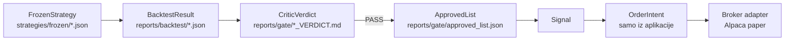

# Zajednički ugovori

Ugovori su "jezik" kojim se trake tima (stroj za backtest, Critic, aplikacija) dogovaraju. Svaka traka piše i čita
samo ove oblike podataka, pa se ne mora znati kako druga traka radi iznutra. Definirani su u
[`lab/contracts.py`](../../lab/contracts.py) (pydantic modeli, spremaju se kao JSON). **Mijenja ih samo orkestrator.**

**Usporedba:** to je kao standardni obrazac na šalteru. Nije bitno tko ga popunjava, bitno je da svi znaju gdje je koje polje.

## Tok

## Modeli

| Model | Tko piše | Tko čita | Svrha |
|-------|----------|----------|-------|
| `FrozenStrategy` | Traka C (hipoteze) | A, Critic | Zamrznuto pravilo: hipoteza, mehanizam, ulaz, izlaz, veličina, troškovi |
| `BacktestResult` | Traka A (stroj) | Critic, aplikacija | Rezultat po tickeru: IS / WF / HO, n, prinos, Sharpe, pad, zastavice, K |
| `CriticVerdict` | Traka C (Critic) | svi | 14 provjera s pravim brojevima, PASS ili FAIL |
| `ApprovedList` | samo Critic | aplikacija | Jedini popis strategija koje smiju biti `APPROVED` |
| `Signal` | aplikacija / stroj | korisnik | KUPI / PRIČEKAJ / NE KUPUJ + `APPROVED` ili `EXPERIMENTAL` |
| `OrderIntent` | aplikacija | broker adapter | Što aplikacija traži od brokera. **Stop je obavezan** |
| `Broker` (sučelje) | aplikacija | aplikacija | Zamjenjivi adapter brokera (vidi dolje) |

## Fiksna pravila u ugovorima

- Razdoblja: IS 2016-01-04 → 2020-12-31, WF 2021-01-01 → 2023-12-31, HO 2024-01-01 →.
- Troškovi zadano: 5 bps round trip + 1 tick po strani. Critic dodatno traži stres 2×.
- `PAPER_ONLY = True`. Nema live naloga.
- `Validation.EXPERIMENTAL` znači: nije prošlo Critic, samo prospektivni test, mala veličina, tvoje uključenje po strategiji.
- Aplikacija ovisi o `Broker` sučelju, **nikad izravno o Alpaci**. Jednog dana za live trading iz Hrvatske možda će trebati
  drugi broker dostupan unutar EU, pa se mijenja samo adapter. Vidi [regulation-eu-hr](../guides/regulation-eu-hr.md).

## Registar pravila (rule types)

`entry.type` i `exit.type` u `FrozenStrategy` moraju biti registrirani u `lab/strategies/registry.py` (vlasnik: traka A).
Prvo se registar objavi, pa tek onda traka C zamrzava strategije koje ga koriste.

## K i ledger

Svako pokretanje strategije dodaje redak u `reports/ledger/trials.jsonl`. Nasljeđeni K iz starije kampanje je **46**
(`LEGACY_K`), novi pokušaji se dodaju na to. K ulazi u Deflated Sharpe.
