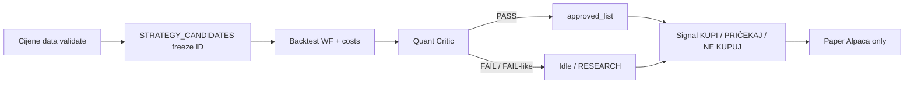

# Pipeline — Memory Lab (jedna stranica)

Paper Alpaca only. **Nema live ordera.**  
Skills **freeze / WF / Critic** = hard gates. Alati ne odobravaju KUPI.  
Prazan `approved_list` → Signal **PRIČEKAJ**.

## Koraci (brojevi)

1. **Cijene / data validate** — OHLCV CSV (`data/ohlcv/`), split-adjust, DATA_CHECK / Cijene OK.
2. **STRATEGY_CANDIDATES freeze ID** — ulaz/izlaz/size zamrznuti (C# / H# / research ID); zapis u candidates + opcionalno `strategies/frozen/`.
3. **Backtest WF + costs** — IS → WF → holdout; costs (npr. 5 bps RT + 1 tick/side); `scripts/backtest_*.py` → `reports/backtest/`.
4. **Quant Critic** — gate checklist; PASS ili FAIL / FAIL-like. FAIL ≠ Signal.
5. **`approved_list`** — samo Critic PASS ID-evi. Inače lista prazna.
6. **Signal** — **KUPI** / **PRIČEKAJ** / **NE KUPUJ** isključivo prema listi + paper rules. Empty list = **PRIČEKAJ**.

## Mermaid

## Signal istina

| Stanje | Signal |
|--------|--------|
| `approved_list` prazan | **PRIČEKAJ** |
| Critic PASS + ID na listi + setup OK | **KUPI** (paper, size per freeze) |
| Setup ne valja / risk / data gap | **NE KUPUJ** ili **PRIČEKAJ** |

## Skills po koraku

Instalirani skillovi (`.claude/skills/`) pomažu u svakom koraku, ali su savjetodavni. Mapa korak → skill
je u `AGENTS.md` (odjeljak "Research skills"), a izvori i commitovi u `docs/research/SKILLS_SHORTLIST.md`.
Verdikt skilla nikad nije Critic PASS.

Vidi i: [overview.md](overview.md), [data.md](data.md), [backtest.md](backtest.md), [signal.md](signal.md),
[../critic/CRITIC_CRITERIA.md](../critic/CRITIC_CRITERIA.md), [roadmap.md](roadmap.md), `AGENTS.md`,
[../research/OSS_SHORTLIST.md](../research/OSS_SHORTLIST.md), [../research/ML_TRACK.md](../research/ML_TRACK.md),
[../research/SKILLS_SHORTLIST.md](../research/SKILLS_SHORTLIST.md).
