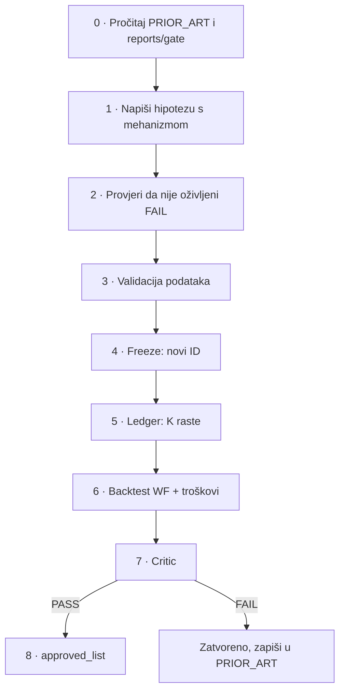

# Nova hipoteza: korak po korak

Sutra se lab nastavlja **samo** novom hipotezom. Ovo je postupak od ideje do verdikta. Nijedan korak se ne preskače,
a pad na bilo kojem znači stop.

## Koraci

0. **Pročitaj** `PRIOR_ART.md` i sve u `reports/gate/`. To su stvari koje već nisu prošle.
1. **Hipoteza s mehanizmom.** Jednom rečenicom: koje ponašanje tržišta iskorištavaš i **tko je s druge strane i zašto**
   (skill `hypothesis-driven-strategy-design`). "Pada pa raste" nije hipoteza. Odredi tip događaja i parametre iz teorije,
   ne iz rezultata.
2. **Nije oživljeni FAIL.** Ne smije biti u obitelji koja je zatvorena (RSI / C10, MEM_CYCLE_MR_V1, MEM_RS_RECLAIM_V1, C1–C9, C12, C10b, C11, H1–H3, HN2proxy, H-N3). Mora se materijalno razlikovati: druga pravila ili drugi univerzum.
3. **Validacija podataka:** `python scripts/validate_data.py` (exit 1 = stop). Za WDC dnevne podatke provjeri spin-off (vidi `docs/architecture/data.md`).
4. **Freeze:** zapiši ulaz, izlaz, veličinu i univerzum u `strategies/frozen/{YYYY-MM-DD}_{ID}.json` + `.md`. ID je nov i ne ponavlja stari broj.
5. **Ledger:** novi red u `STRATEGY_CANDIDATES.md` i u `trading-lab/ledger/trials.jsonl`. K raste, i taj broj ulazi u Critic.
6. **Backtest:** IS 2016–2020, WF 2021–2023, HO 2024 →, troškovi 5 bps RT + 1 tick po strani. Izvještaj u `reports/backtest/{ID}_{TICKER}.md`. Holdout ne dirati dok ne dođe red.
7. **Critic:** prođi `docs/critic/CRITIC_CRITERIA.md`, upiši `reports/gate/{YYYY-MM-DD}_{ID}_VERDICT.md`.
8. **PASS:** upis u `reports/gate/approved_list.json`. **FAIL:** zatvoreno, kratak razlog u `PRIOR_ART.md`.

## Pomoćni skillovi po koraku

Mapa je u `AGENTS.md` (odjeljak "Research skills"). Primjeri: korak 1 `hypothesis-driven-strategy-design`, korak 6
`walk-forward-validation` i `transaction-cost-and-market-impact-modeling`, korak 7 `lookahead-bias-detection-methodology`
i `statistical-significance-and-deflated-metrics`. Verdikt skilla nikad nije Critic PASS.

## Kontrolna lista prije nego počneš

- [ ] Hipoteza ima mehanizam i odgovor na "tko je s druge strane".
- [ ] Nije zatvorena obitelj i razlikuje se od FAIL-ova.
- [ ] Parametri su iz teorije, ne iz rezultata.
- [ ] Novi ID, red u `STRATEGY_CANDIDATES.md`, freeze datoteka.
- [ ] Podaci prošli validaciju.
- [ ] Znam što je holdout i neću ga gledati unaprijed.
