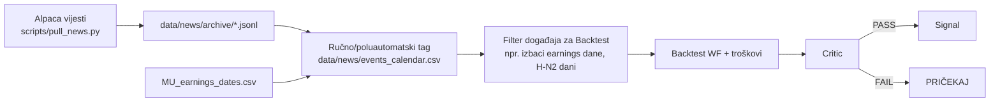

# News pipeline (struktura, ne trading)

Kako vijesti ulaze u lab, bez gledanja u budućnost.

## Datoteke
- `data/news/archive/news_2016-01-01_now.jsonl` — sirove Alpaca/Benzinga vijesti (naslov, sažetak, tickeri, vrijeme UTC). Bez punog teksta.
- `data/news/events_calendar.csv` — 58 provjerenih događaja: 43 Micron rezultata + 15 velikih (carine, Broadcom, Korea, Samsung, Toshiba). Stupci: `event_date`, `us_reaction_date` (prvi US dan kad cijena može reagirati), `type`, `tickers`, `description`, `source_url`, `verified`.
- `data/news/MU_earnings_dates.csv` — 43 izvještaja s reakcijama.

## Pravila protiv varanja (look-ahead)
1. Vijest objavljena nakon 22:00 ZG (nakon zatvaranja US) smije utjecati tek na idući dan.
2. Za H-N2 (Koreja → MU): SKHY trguje u US satima, pa ne može "voditi" MU preko noći. Čisti test: **SKHY gap na otvaranju** (≈ korejski noćni pomak) → **MU od otvaranja do zatvaranja**, sve po cijenama otvaranja. SKHY ima samo ~3 mjeseca, DRAM ~6 mjeseci: premalo za PASS, dovoljno za praćenje.
3. Tip događaja se zapisuje prije testa (freeze), ne nakon što vidimo ishod.

## Što još fali
- Društvene mreže (Reddit/X): nisu povučene, treba dogovoren izvor (npr. Apify). Nikad izmišljen sentiment.
- Korejski rezultati (Samsung 8.10., SK Hynix krajem 10. — datum nepotvrđen) se dodaju u kalendar kad izađu.
