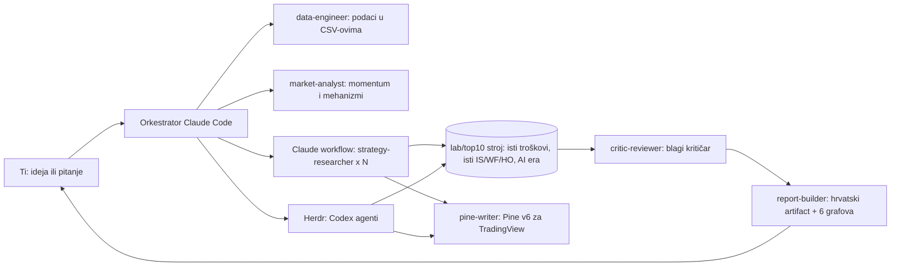

# Tim AI agenata: nacrt i kako se koristi (14. 10. 2026.)

Ovaj dokument opisuje tim koji je ovaj krug stvarno izgradio i pokrenuo. Nacrt čeka tvoje odobrenje prije daljnjeg širenja.
Agenti **nikad** ne šalju naloge. Trguješ ti, kroz TradingView spojen na Interactive Brokers.

## Slika u jednoj rečenici

Orkestrator (Claude Code) dijeli posao na male, nezavisne zadatke. Svaki zadatak radi poseban agent, a svi koriste isti stroj za
testiranje (`lab/top10/`) pa su rezultati usporedivi. Claude agenti rade preko workflowa, Codex agenti u Herdr panelima.

## Uloge (`.claude/agents/`, svi na Sonnet 5.5)

| Agent | Zadatak | Piše u |
|---|---|---|
| `data-engineer` | povlačenje, provjera i katalog podataka (dionice, ETF-ovi, zlato i srebro, kripto) | `data/`, `docs/research/DATA_CATALOG.md` |
| `market-analyst` | proučava momentum i mehanizme tržišta prije nego što nastane hipoteza | `reports/research/` |
| `strategy-researcher` | jedna hipoteza, jedan modul, jedno zamrzavanje, jedan upis u ledger | `lab/top10/strategies/`, `strategies/frozen/` |
| `pine-writer` | Pine v6 replika za učenje i vizualni backtest | `scripts/tradingview/` |
| `critic-reviewer` | blagi kritičar: provjerava valjanost, ne veličinu rizika | `reports/research/TOP10_20261014/{ID}/critic.md` |
| `report-builder` | piše narativ na hrvatskom i gradi stranicu | `.../narrative.json`, `artifact.html` |

## Stroj za testiranje (`lab/top10/`)

- Odluka na zatvaranju, kupnja na idućem otvaranju. Troškovi: 5 baznih bodova (dionice i ETF-ovi), 20 (kripto), 2 (forex).
- Troškovi se naplaćuju i za vraćanje na ciljne udjele nakon pomaka cijena. Kalendar sadrži samo dane na kojima svi dionički instrumenti imaju stvaran bar.
- Razine: dnevno, satno, 5-minutno, 1-minutno (`TIMEFRAME` u modulu).
- Provjere: lookahead (skraćivanje podataka), trošak 2× i 3×, parametri ±20 %, PBO, PSR, deflated Sharpe (informativno).
- **AI era (od 2023.) nosi ocjenu**, razdoblje prije 2022. je kontekst i upozorenje na promjenu režima.
- Kritičar je blag: ZELENO, ŽUTO ili CRVENO. Veličina pada i koncentracija ne spuštaju ocjenu.

## Kako se koristi svaki dan

1. Ideja: napiši je kao hipotezu s mehanizmom, ili je prvo istraži `market-analyst`.
2. `strategy-researcher` napiše modul i zamrzne ga (jedan run). Promjena ideje znači novi ID.
3. `pine-writer` napiše skriptu, a orkestrator je kompajlira u TradingViewu preko lokalnog MCP-a.
4. `critic-reviewer` napiše kritiku, `report-builder` složi stranicu, orkestrator je objavi.

## Codex preko Herdra

Dva Codex agenta (`codex-a`, `codex-b`) rade u Herdr panelima, u `workspace-write` sandboxu bez odobravanja svakog koraka. Prijava ide preko
ChatGPT računa (OAuth), ne preko API ključa. Prednost je neovisna provjera: Codex je u ovom krugu našao tri stvarne greške u stroju
(trošak rebalansiranja, najveći pad bez početnog kapitala, izvršenje na ne-postojećem baru) i sve su ispravljene.

## Otvorena pitanja za tebe

- Želiš li varijante s polugom ili kratkom prodajom? Stroj je zasad samo dugo i bez poluge (zadano za EU/HR). Dodavanje je malo.
- Fizičko zlato i srebro (XAU/futures) traže IBKR kao izvor podataka. Zasad su metali ETF-ovi (GLD, SLV, rudari).
- Dopuna podataka do danas treba posebnu skriptu (postojeći pull ne dopisuje u već postojeće datoteke).
